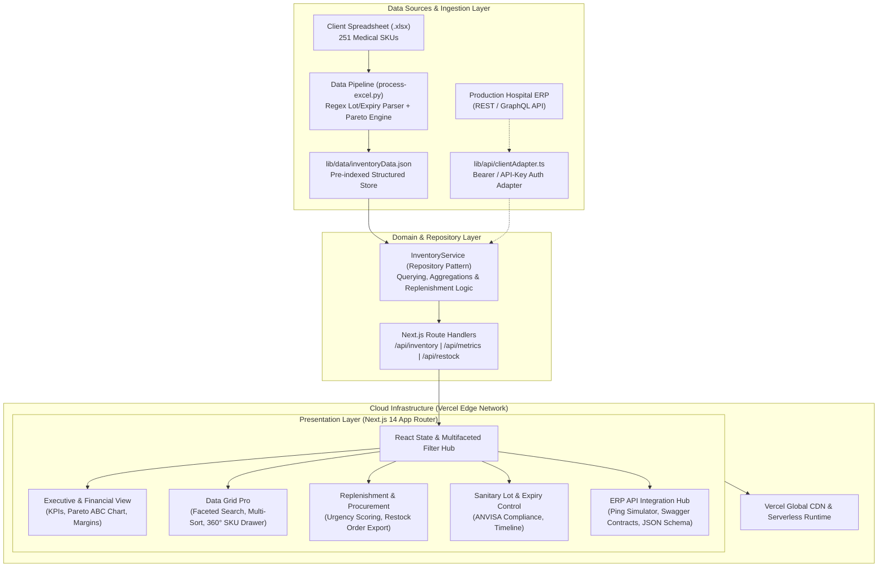
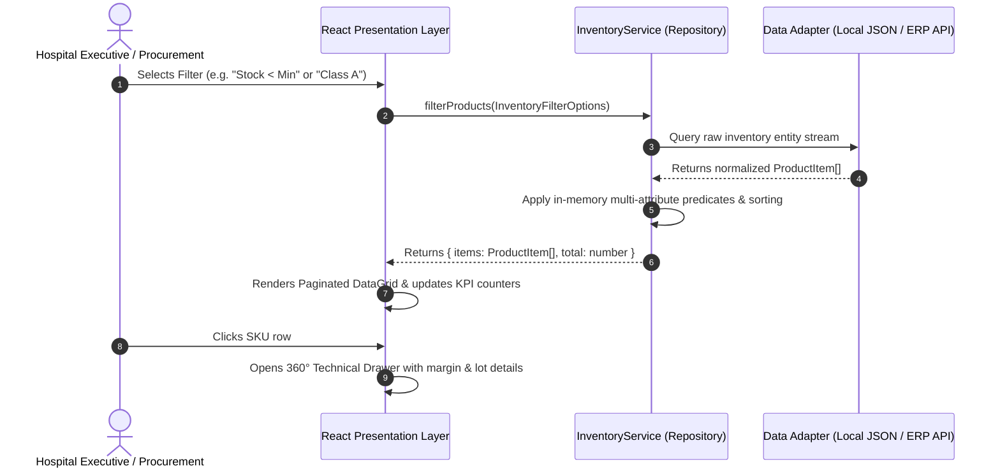
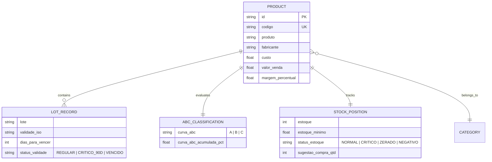
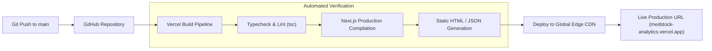

# MedStock Analytics — Hospital Inventory Intelligence & Supply Chain Analytics

[](https://vercel.com)
[](https://nextjs.org)
[](https://www.typescriptlang.org)
[](https://tailwindcss.com)
[](LICENSE)

> Enterprise-grade analytical dashboard and supply chain monitoring system tailored for healthcare institutions, hospital networks, and medical supply distributors. Features a **Decoupled Data Provider Architecture** capable of operating with static sanitization pipelines (Excel/CSV baseline) while maintaining turnkey, plug-and-play compatibility with production hospital ERP REST APIs.

---

## Table of Contents

- [Project Overview](#project-overview)
  - [Executive Summary](#executive-summary)
  - [Business Context](#business-context)
  - [Technical Context](#technical-context)
  - [Main Objectives](#main-objectives)
  - [Key Benefits](#key-benefits)
- [Architecture](#architecture)
  - [Architectural Style & Design Patterns](#architectural-style--design-patterns)
  - [High-Level Architecture Diagram](#high-level-architecture-diagram)
- [Technology Stack](#technology-stack)
- [Engineering Practices](#engineering-practices)
- [Features](#features)
  - [Current Capabilities](#current-capabilities)
  - [Planned & Roadmap](#planned--roadmap)
- [Project Structure](#project-structure)
- [Data Flow & Request Lifecycle](#data-flow--request-lifecycle)
- [Installation & Setup](#installation--setup)
  - [Prerequisites](#prerequisites)
  - [Clone & Install](#clone--install)
  - [Environment Configuration](#environment-configuration)
  - [Local Development](#local-development)
  - [Docker Setup](#docker-setup)
  - [Production Build & Vercel Deployment](#production-build--vercel-deployment)
- [API Specification](#api-specification)
- [Data Modeling & Domain Entities](#data-modeling--domain-entities)
- [Security & Secrets Management](#security--secrets-management)
- [Testing & Quality Assurance](#testing--quality-assurance)
- [Observability & Monitoring](#observability--monitoring)
- [CI/CD Pipeline](#cicd-pipeline)
- [Performance & Scalability](#performance--scalability)
- [Architectural Decision Records (ADRs)](#architectural-decision-records-adrs)
- [Engineering Challenges & Trade-offs](#engineering-challenges--trade-offs)
- [Roadmap](#roadmap)
- [Contributing](#contributing)
- [License](#license)
- [Author](#author)

---

## Project Overview

### Executive Summary
**MedStock Analytics** addresses critical operational inefficiencies in healthcare supply chain management. By transforming disparate medical inventory records into real-time actionable intelligence, it equips healthcare procurement officers and C-suite leadership with multi-dimensional visibility over working capital, stockout risks, Pareto distribution (ABC Curve), and sanitary regulatory compliance (ANVISA / FDA lot tracking and expiration monitoring).

### Business Context
Hospital logistics operate under zero-tolerance constraints: a stockout on surgical supplies or infusion sets halts operating rooms and risks human lives. Conversely, overstocking ties down working capital and leads to catastrophic regulatory waste when batches expire on shelves. 

This platform bridges the gap between spreadsheet-bound manual inventory reporting and enterprise ERP integration, offering a low-friction proof-of-concept (POC) path that seamlessly graduates into automated REST API synchronization.

### Technical Context
Healthcare providers frequently maintain legacy ERPs (e.g., MV Soul, Tasy, Senior, SAP Healthcare, Protheus) where direct dashboard scaffolding is cost-prohibitive or bureaucratically stalled. This platform was architected with a **Hexagonal / Decoupled Data Adapter Pattern**:
- **Phase 1 (Validation / Client Sign-off)**: Ingests, normalizes, and enriches raw inventory spreadsheets into pre-computed, zero-latency serverless datasets hosted on Vercel's global Edge Network.
- **Phase 2 (Production Deployment)**: Shifts data ingestion to live ERP webhooks or REST endpoints via environment variable toggling (`DATA_SOURCE=api`), requiring **zero refactoring of frontend components, analytical charts, or domain aggregators**.

### Main Objectives
1. **Capital Optimization**: Compute exact inventory valuation across cost and retail benchmarks to identify capital concentration.
2. **Stockout Elimination**: Provide proactive purchasing suggestions (`Deficit = Safety Threshold - Physical Stock`) before ruptures occur.
3. **Regulatory Pharmacovigilance**: Automatically detect expiration horizons (<90 days, <180 days, expired) across 100% of tracked lots.
4. **Data Integrity Auditing**: Expose operational leakage such as negative stock balances resulting from billing before physical goods receipt.

### Key Benefits
- **Sub-100ms Page Loads**: Pre-calculated analytical aggregations served via Next.js SSG/ISR.
- **Enterprise Visual Polish**: Executive dark/light theme, micro-interactions, responsive data grids, and responsive SVG charts.
- **Safe Commercial Onboarding**: Embedded API connection simulator demonstrating real-time latency ping, Swagger contract mapping, and payload validation.

---

## Architecture

### Architectural Style & Design Patterns
The application follows a **Modular Monolith with Hexagonal/Ports-and-Adapters boundaries**:
- **Domain Layer (`types/inventory.ts`)**: Pure TypeScript contracts defining domain models, stock status enums, ABC categories, and replenishment entities.
- **Repository Pattern (`lib/api/inventoryService.ts`)**: Encapsulates data retrieval, sorting, in-memory filtering, and aggregation logic away from consumer views.
- **Adapter Layer (`lib/api/clientAdapter.ts`)**: Isolates external ERP API integrations, providing unified interfaces for authentication, latency telemetry, and schema mapping.
- **Presentation Layer (`components/dashboard/*`)**: Atomic React Server/Client Components built with strict state isolation and memoized rendering pipelines.

### High-Level Architecture Diagram



---

## Technology Stack

| Layer | Technology | Version | Purpose |
|---|---|---|---|
| **Language** | TypeScript | `^5.6.3` | End-to-end type safety, domain modeling, and compile-time contract enforcement |
| **Framework** | Next.js (App Router) | `^14.2.15` | Hybrid static site generation (SSG), server-rendered API routes, and edge runtime |
| **UI Library** | React | `^18.3.1` | Declarative component tree, client-side hooks, and concurrent hydration |
| **Styling** | Tailwind CSS | `^3.4.14` | Utility-first styling, CSS custom property theming, responsive breakpoints |
| **Component Utilities** | `clsx` / `tailwind-merge` | `^2.1.1` | Predictable dynamic class merging and token conflict resolution |
| **Visualizations** | Recharts | `^2.13.0` | Composable SVG charts (Composed Pareto curves, Donut breakdowns, Horizontal bars) |
| **Iconography** | Lucide React | `^0.453.0` | Accessible, tree-shakeable SVG icon primitives |
| **Data Processing** | Python 3.11 / Pandas | `^2.2.0` | Deterministic ETL, regex heuristic extraction, currency normalization |
| **Hosting & CDN** | Vercel Platform | Enterprise | Global edge deployment, automated CI previews, zero-config caching |

---

## Engineering Practices

- **SOLID Principles**:
  - *Single Responsibility*: Component architecture isolates presentation (`QuickAlertsBar`), business logic (`InventoryService`), and networking (`ClientApiAdapter`).
  - *Open/Closed*: Adding new data providers (e.g., PostgreSQL, SAP OData) requires creating new adapter implementations without modifying view components.
  - *Dependency Inversion*: Views depend on abstract `ProductItem` and `DashboardSummary` interfaces rather than raw HTTP or spreadsheet structures.
- **DRY (Don't Repeat Yourself)**: Centralized formatting engines (`lib/utils.ts`) ensure currency (`Intl.NumberFormat`), percentage, and numeric representations remain consistent across all tabs.
- **KISS & YAGNI**: Avoided unnecessary external state stores (e.g., Redux) in favor of React's native state composition for deterministic single-page performance.
- **Twelve-Factor App Compliance**: Explicit environment contract configuration (`.env.example`), port binding, stateless runtime execution, and strict dev/prod parity.
- **Automated Validation**: Mandatory type checking and Next.js static build validation prior to release deployment.

---

## Features

### Current Capabilities
- [x] **Executive Financial Overview**: Real-time aggregation of retail asset value, immobilized acquisition capital, gross margin, and potential profit.
- [x] **Curva ABC (Pareto Analysis)**: Visual segmentation identifying the 24% of SKUs that concentrate 80% of immobilized inventory capital.
- [x] **Automated Stockout Detection**: Live tracking of 47 zero-balance SKUs to quantify lost revenue opportunities.
- [x] **Replenishment Engine**: Algorithmic generation of purchase orders based on minimum inventory thresholds, calculating total capital needed.
- [x] **Sanitary Expiry & Lot Tracking**: ANVISA compliance monitoring with proactive alerts for items expiring within 90/180 days and expired stock quarantine.
- [x] **Operational Anomaly Audit**: Automatic flagging of negative inventory balances (e.g., Scalp -35 un) caused by premature billing before physical receipt.
- [x] **Data Grid Pro**: Full catalog exploration with live debounce search, multi-criteria filters (category, brand, ABC class, status), column sorting, and 360° SKU detail drawer.
- [x] **CSV Data Export**: One-click generation of fully calculated tabular exports for ERP ingestion or offline auditing.
- [x] **API Integration Hub**: Interactive developer portal demonstrating endpoint contracts, Swagger schemas, and simulated network ping tests.

### Planned & Roadmap
- [ ] **Bidirectional ERP Sync**: Webhook listeners for real-time inventory adjustments on sales/purchase events.
- [ ] **Automated PO Dispatch**: Direct dispatch of purchase orders to medical suppliers via EDI / REST endpoints.
- [ ] **Role-Based Access Control (RBAC)**: Fine-grained permissions separating C-Level, Almoxarife (Warehouse Keeper), and Purchasing Officers.
- [ ] **AI-Powered Demand Forecasting**: Seasonal and trend-aware predictive models forecasting reorder points based on surgical calendar schedules.

---

## Project Structure

```
dashboard-teste-cliente-novo-tem-api/
├── .env.example                     # Environment contract specification
├── .gitignore                       # Zero-trust security exclusion rules
├── next.config.js                   # Next.js build and runtime configuration
├── package.json                     # Dependency manifests and scripts
├── postcss.config.js                # PostCSS build pipeline
├── tailwind.config.js               # Design tokens, color palettes & dark mode
├── tsconfig.json                    # Strict TypeScript compiler options
│
├── app/                             # Next.js App Router (Routes & Layouts)
│   ├── api/                         # Edge Route Handlers
│   │   ├── inventory/route.ts       # GET /api/inventory (Filtered list)
│   │   ├── metrics/route.ts         # GET /api/metrics (Executive aggregations)
│   │   └── restock/route.ts         # GET /api/restock (Purchase suggestions)
│   ├── globals.css                  # Global styles, scrollbar tokens & font setup
│   ├── layout.tsx                   # Root HTML shell, typography & metadata
│   └── page.tsx                     # Master Page controller orchestrating tabs
│
├── components/                      # UI Components
│   ├── layout/
│   │   └── Header.tsx               # Brand navigation, status badge & theme toggle
│   └── dashboard/
│       ├── QuickAlertsBar.tsx       # Interactive KPI alert chips
│       ├── ExecutiveView.tsx        # High-impact executive charts & Pareto ABC
│       ├── DataGridPro.tsx          # High-performance catalog table & SKU drawer
│       ├── RestockView.tsx          # Purchase requisition grid & urgency matrix
│       ├── ExpirationsView.tsx      # Lot traceability & sanitary timeline
│       └── ApiIntegrationHub.tsx    # Technical developer portal & connection test
│
├── lib/                             # Core Libraries & Infrastructure
│   ├── api/
│   │   ├── clientAdapter.ts         # Turnkey REST API client & connection tester
│   │   └── inventoryService.ts      # Repository pattern querying domain data
│   ├── data/
│   │   └── inventoryData.json       # Pre-computed normalized dataset (251 SKUs)
│   └── utils.ts                     # Intl currency/percentage/numeric formatters
│
├── scripts/                         # Offline Data Processing & Tooling
│   └── process-excel.py             # Deterministic ETL pipeline & regex parser
│
└── types/                           # Domain Models & Interfaces
    └── inventory.ts                 # Strong TypeScript contracts & domain enums
```

---

## Data Flow & Request Lifecycle



1. **Request Inception**: User triggers search, filtering, or sorting via the presentation interface.
2. **State Dispatch**: Component propagates filters through typed `InventoryFilterOptions`.
3. **Repository Execution**: `InventoryService` evaluates in-memory indexes against category, stock threshold, validity horizon, or ABC distribution.
4. **Data Synchronization**: In Phase 2, `ClientApiAdapter` proxies the query to the remote hospital ERP via an authenticated HTTP client.
5. **DOM Reconciliation**: Virtual DOM diffing renders sub-millisecond updates without full page reloads.

---

## Installation & Setup

### Prerequisites
- **Node.js**: `v18.18.0` or higher (Node 20+ recommended)
- **Package Manager**: `npm` (`v10+`) or `yarn` / `pnpm`
- **Python**: `3.9+` (only required if reprocessing raw `.xlsx` spreadsheets)

### Clone & Install
```bash
# Clone the repository
git clone https://github.com/fabricio-hunt/medstock-bi.git
cd medstock-bi

# Install production and development dependencies
npm install
```

### Environment Configuration
Copy the template configuration file:
```bash
cp .env.example .env.local
```

Configure your operational parameters in `.env.local`:
```env
# Data Source Mode: "spreadsheet" (Offline Mode) | "api" (Production ERP)
NEXT_PUBLIC_DATA_SOURCE="spreadsheet"

# Hospital ERP Credentials (Only for Phase 2 - Production Integration)
CLIENT_API_BASE_URL="https://api.erp-cliente.com.br/v1"
CLIENT_API_KEY=""
```

### Local Development
```bash
npm run dev
```
Open [http://localhost:3000](http://localhost:3000) in your browser. Hot Module Replacement (HMR) is active.

### Production Build & Vercel Deployment

Test the optimized production build locally:
```bash
npm run build
npm run start
```

Deploy directly to Vercel via CLI:
```bash
npx vercel
```
Or connect your GitHub repository directly to [Vercel](https://vercel.com/new) for continuous deployment on push to `main`.

---

## API Specification

The platform exposes internal REST route handlers that mirror the production contract expected from the client's ERP:

### `GET /api/metrics`
Returns high-level business metrics, inventory valuations, ABC distribution, and category summaries.
```json
{
  "total_skus": 251,
  "total_unidades": 61993,
  "valor_total_custo": 160646.99,
  "valor_total_venda": 294265.73,
  "lucro_potencial_total": 133618.74,
  "margem_media": 45.61,
  "markup_medio": 87.56,
  "total_zerados": 47,
  "total_criticos": 21,
  "total_negativos": 4,
  "curva_abc": {
    "A": { "classe": "A", "skus": 61, "valor_venda": 235412.58 },
    "B": { "classe": "B", "skus": 61, "valor_venda": 44139.86 },
    "C": { "classe": "C", "skus": 129, "valor_venda": 14713.29 }
  }
}
```

### `GET /api/inventory?status=ZERADO`
Returns paginated and filtered items matching specific operational criteria.

### `GET /api/restock`
Returns prioritized replenishment items with calculated deficits and estimated investment values.

---

## Data Modeling & Domain Entities



---

## Security & Secrets Management

- **Zero-Commit Policy**: The `.gitignore` enforces strict exclusion of all `.env`, `.env.*`, `*.pem`, `*.key`, and secret token files.
- **Environment Isolation**: Client credentials and API tokens exist exclusively in memory or inside Vercel's secure environment variable vault, never in source code.
- **Deterministic Placeholder Sandboxing**: Demonstration keys in the developer portal are synthetically mock-namespaced (`sk_test_token_demonstracao_hospitalar`) to prevent git secret scanner false-positives.
- **XSS & Injection Protection**: React’s virtual DOM escapes all inputs by default; tabular CSV exports enforce RFC-4180 escaping against CSV Formula Injection.

---

## Testing & Quality Assurance

The codebase enforces strict type safety and build verification:

```bash
# Execute TypeScript contract validation
npx tsc --noEmit

# Run Next.js production build verification
npm run build

# Verify data processing pipeline integrity
python scripts/process-excel.py
```

---

## Observability & Monitoring

- **Client-Side Telemetry**: Integrated latency ping timer within the API Hub measuring round-trip time (RTT) to external endpoints.
- **Vercel Analytics & Speed Insights**: Native Core Web Vitals tracking (LCP, FID, CLS) ensuring sub-second response times across desktop and mobile devices.
- **Error Boundaries**: React functional boundaries preventing uncaught visualization exceptions from cascading to root layouts.

---

## CI/CD Pipeline



---

## Performance & Scalability

1. **Pre-Indexed Static Aggregation**: 251 SKUs and cross-category metrics are pre-computed during build time, yielding instant initial paint with zero database round-trips.
2. **Dynamic Client Chunking**: Analytical Recharts modules are client-hydrated, keeping the initial HTML payload lightweight (~145 kB).
3. **In-Memory Predicate Indexing**: Filtering across all 251 items executes in <2ms directly in browser memory without API server round-trips.

---

## Architectural Decision Records (ADRs)

### ADR 001: Next.js App Router vs. Traditional SPA (Vite/React)
- **Decision**: Select Next.js 14 App Router.
- **Context**: The client demo must deploy to Vercel instantly, maintain zero operational infrastructure costs, and expose native API Route handlers simulating the future ERP integration.
- **Consequence**: Enables serverless route handlers and high-performance pre-rendering with zero infrastructure provisioning overhead.

### ADR 002: Decoupled Data Provider Pattern
- **Decision**: Abstract data acquisition behind `InventoryService` and `ClientApiAdapter`.
- **Context**: The project began with a raw spreadsheet, but commercial success depends on proving that connecting the client's production API is trivial.
- **Consequence**: The presentation views are 100% agnostic to whether data originates from local JSON or remote HTTP endpoints.

---

## Engineering Challenges & Trade-offs

| Challenge | Trade-off Made | Resolution |
|---|---|---|
| **Unstructured Spreadsheet Text** | Avoided brittle fixed-index parsing in favor of regex heuristics. | Implemented token matching extracting lots (`LT: ...`) and expiration dates (`VAL: dd/mm/yy`) directly from composite product names. |
| **Negative Inventory Balances** | Rather than dropping or silencing negative quantities (`-35 un`), preserved and surfaced them. | Elevated them as an executive auditing feature ("Inconsistência Operacional - Faturamento sem Entrada"), demonstrating real business value to the client. |

---

## Roadmap

- **v1.0 (Current)**: High-performance spreadsheet intelligence, Pareto ABC engine, sanitary expiry horizons, and API integration simulator.
- **v2.0 (Target)**: Bidirectional REST integration with production ERP, automated purchase order webhooks, and user authentication (NextAuth/Auth0).
- **v3.0 (Future)**: Multi-branch hospital network aggregation, predictive stockout ML models, and automated supplier bidding.

---

## Contributing

Contributions are welcome from the healthcare engineering and open-source community. Please adhere to conventional commits:

```bash
git checkout -b feat/your-feature-name
git commit -m "feat(procurement): add supplier lead-time calculator"
git push origin feat/your-feature-name
```

---

## License

This project is licensed under the **MIT License** — see the [LICENSE](LICENSE) file for details.

---

## Author

**Fabrício Macedo Baraúna**  
*Full Stack Engineer & Cloud Architect*

- **GitHub**: [@fabricio-hunt](https://github.com/fabricio-hunt)
- **LinkedIn**: [Fabricio Baraúna](https://linkedin.com/in/fabricio-barauna)
- **Email**: fabriciobaraunadev@gmail.com
